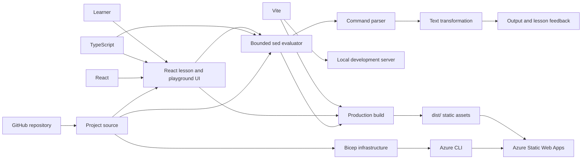

# sed lab

An interactive, browser-based sandbox for learning Unix text-processing concepts by experimenting with a safe subset of `sed`.

**Live app:** https://red-mushroom-0ca7bc30f.4.azurestaticapps.net

## Learning model

The project follows a short feedback loop:

1. Read a focused explanation of one Unix concept.
2. Edit a command against sample text.
3. See the transformed output immediately.
4. Check the result against the lesson goal.
5. Move into the open playground and experiment.

The first module teaches:

- Substitution with `s/pattern/replacement/`
- Global and case-insensitive flags (`g` and `i`)
- Numeric line addresses, such as `2d`
- Deleting and printing lines with `d` and `p`
- Quiet output with `sed -n`
- Basic regular-expression characters and character classes

This is intentionally a learning environment, not a complete GNU or BSD `sed` implementation.

## Dependency graph



## Toolchain

| Layer | Tool | Role |
|---|---|---|
| Learning interface | React 19 | Renders lessons, hints, feedback, and the playground |
| Language | TypeScript 5.9 | Adds static types to the UI and evaluator |
| Development/build | Vite 7 | Runs the local server and produces optimized static assets |
| Package management | npm | Installs the dependency graph recorded in `package-lock.json` |
| Command model | Browser-native JavaScript | Parses and evaluates the supported `sed` subset |
| Infrastructure as Code | Bicep | Defines the Azure resource group and Static Web App |
| Cloud operations | Azure CLI | Validates and deploys the Bicep infrastructure |
| Hosting | Azure Static Web Apps Free | Serves the compiled site over managed HTTPS |
| Source control | Git and GitHub | Stores project history and supports future collaboration |

### Runtime dependencies

- `react` renders the application.
- `react-dom` mounts the React tree in the browser.

### Development dependencies

- `typescript` checks and compiles TypeScript.
- `vite` runs the development server and production build.
- `@vitejs/plugin-react` integrates React with Vite.
- `@types/react` and `@types/react-dom` provide TypeScript definitions.

There is no backend, database, authentication service, or shell process.

## Safe execution model

The playground never passes learner input to a system shell. Commands are handled by the bounded evaluator in `src/sed.ts`.

Safety boundaries include:

- Input limited to 10,000 characters and 500 lines
- Patterns limited to 120 characters
- Only substitution, delete, and print commands
- Only numeric line addresses
- Only `g` and `i` substitution flags
- Deliberately restricted regular-expression syntax
- No file access, process creation, networking, or arbitrary code execution

This design lets learners practice command structure without risking local files or exposing a command-injection surface.

## Project structure

```text
.
├── src/
│   ├── main.tsx                 # Lessons, playground, and feedback UI
│   ├── sed.ts                   # Safe parser and text evaluator
│   └── styles.css               # Application styling
├── public/
│   ├── healthz                  # Static liveness response
│   └── readyz                   # Static readiness response
├── infra/
│   ├── main.bicep               # Subscription-scope deployment entry point
│   ├── main.parameters.json     # Development deployment values
│   └── modules/
│       └── static-web-app.bicep # Static Web Apps resource
├── index.html
├── package.json
└── vite.config.ts
```

## Run locally

### Prerequisites

- Node.js 24 or newer
- npm

```bash
git clone https://github.com/tjpools/SED.git
cd SED
npm install
npm run dev
```

Open http://localhost:3000.

To use another port:

```bash
PORT=4173 npm run dev
```

## Build and preview

```bash
npm run build
npm start
```

The production build is written to `dist/`.

## Deploy application changes

The Azure infrastructure is defined in `infra/`. After it has been provisioned, rebuild and publish application changes with:

```bash
npm run build

export SWA_CLI_DEPLOYMENT_TOKEN="$(
  az staticwebapp secrets list \
    --name swa-sed-sandbox-dev-629a \
    --resource-group rg-sed-sandbox-dev-629a \
    --query properties.apiKey \
    --output tsv
)"

npx --yes @azure/static-web-apps-cli deploy ./dist \
  --app-name swa-sed-sandbox-dev-629a \
  --env production

unset SWA_CLI_DEPLOYMENT_TOKEN
```

Never commit the deployment token.

## Adding another Unix concept

Keep each concept isolated and testable:

1. Define the supported syntax and explicit safety limits.
2. Add a parser/evaluator module under `src/`.
3. Add small lessons with input, starter command, expected output, and hints.
4. Connect the module to the shared playground.
5. Add unit tests for valid commands, invalid input, limits, and edge cases.
6. Update this README with the new dependency and learning flow.

Good candidates for future modules include `grep`, `awk`, pipes, redirection, and regular expressions.

## Current limitations

- The evaluator models only a subset of `sed`.
- GNU- and BSD-specific behavior is not emulated.
- Commands cannot read or modify files.
- Multiple commands and script files are not supported.
- Automated unit tests are not yet configured.

These constraints keep the first version understandable and safe while leaving clear extension points.
